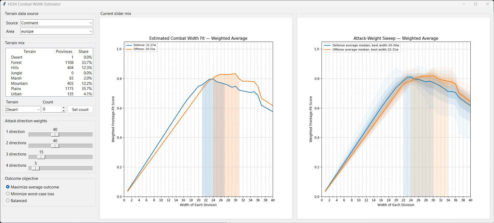

# Hoi4 Combat Width Estimator
Install Python 3

Install pip and the requirements with:

``` python -m pip install -r requirements.txt ```

Double click on ```clickme.pyw``` or use the following command

``` python hoi4cw.py ```


